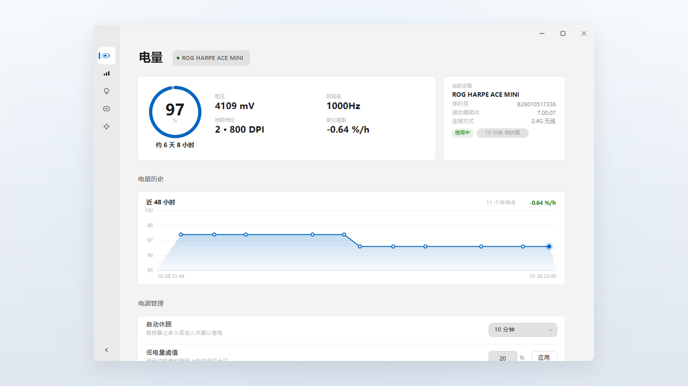
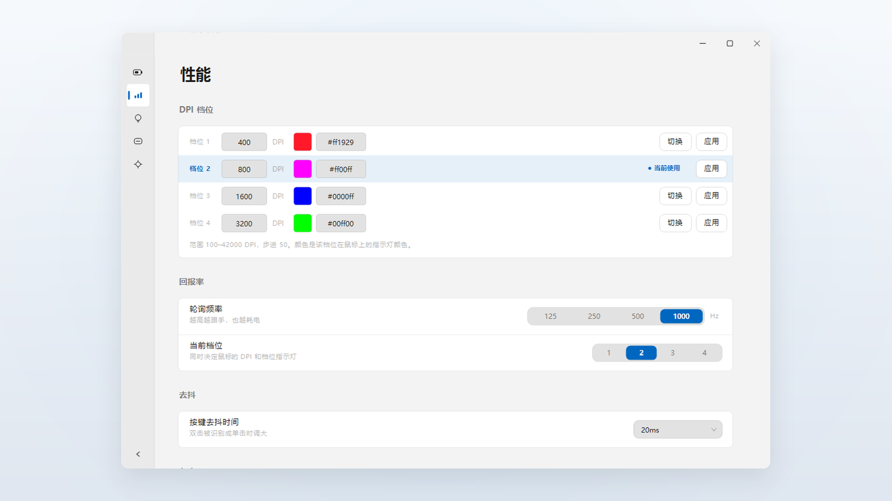
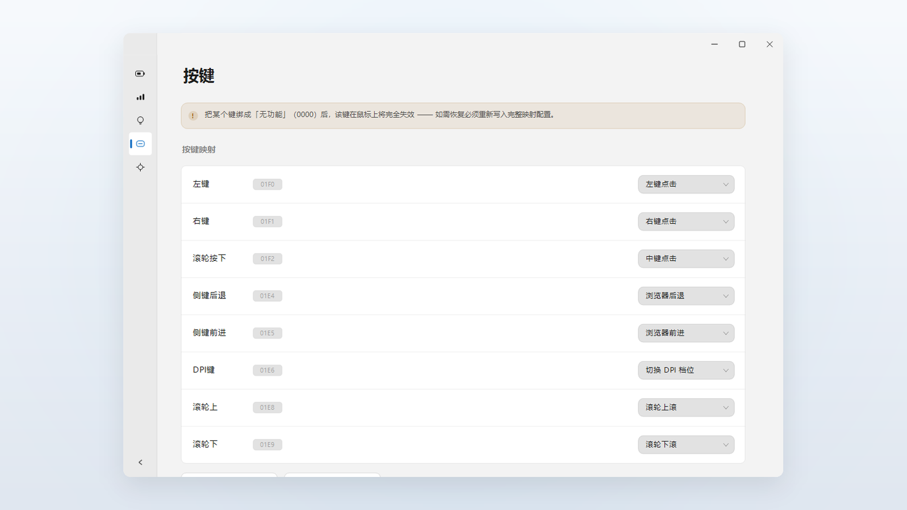
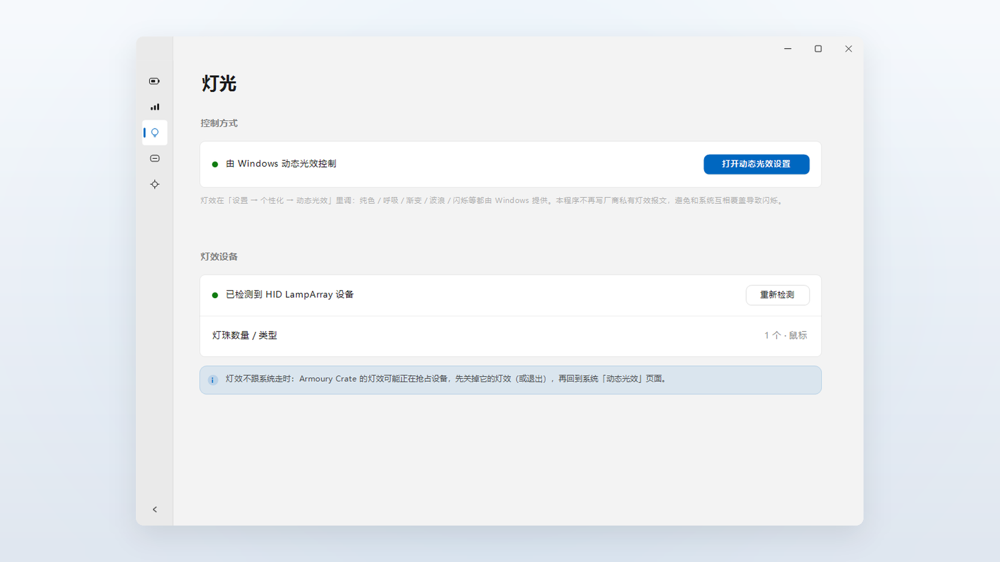
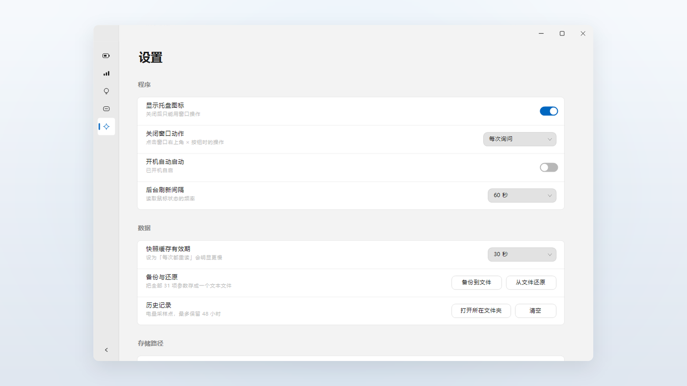
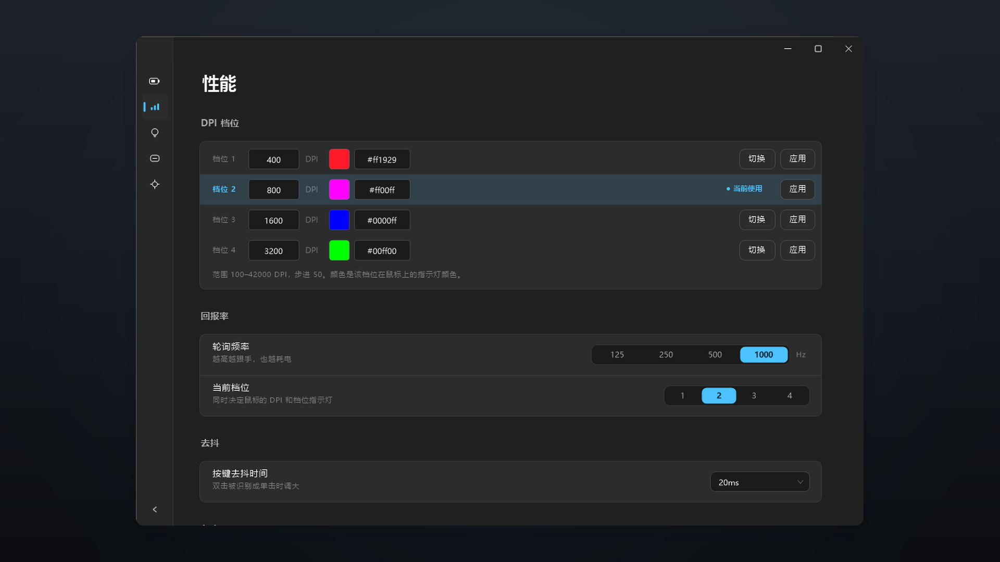

# R Battery · rog-mouse-ctl

**通用的 ROG 鼠标参数控制工具** —— 不装 Armoury Crate、不装驱动，直接把鼠标的 DPI、
回报率、去抖、按键映射和电量状态读出来、改进去。

[](https://github.com/youmikk/ROG-Battery/releases)
[](https://apps.microsoft.com/detail/9nrc8hcd4bz7?hl=zh-CN&gl=CN)

[](https://github.com/youmikk/ROG-Battery/releases)
[](https://github.com/youmikk/ROG-Battery/releases)
[](#系统要求)
[](#安装)
[](#从源码构建)

- 单个 exe 约 **1.0 MB**，零运行时依赖，**不需要管理员权限**，**不联网**
- 双形态：图形界面（五页）+ 命令行（`info` / `setdpi` / `backup` …）
- 直接用 Windows 自带的 HID 接口通信，不碰厂商服务、不留常驻后台

> **型号说明**：本项目针对 **ROG 鼠标这一套私有 HID 参数协议**编写，不是某个型号的专属工具。
> 目前真机验证过的设备是 **ROG HARPE ACE MINI（`0B05:1ACE`，USB 直连 / ROG OMNI RECEIVER 2.4G）**；
> 其它 ROG 鼠标走同一命令族，能力差异会在界面上按项显示「本型号不支持」，而不是假装成功。

## 截图

| 电量 | 性能 |
| --- | --- |
|  |  |
| 电量环 + 环下预计可用时间 + 48 小时曲线 | DPI 四档（含每档灯色）、回报率、去抖、LOD |

| 按键 | 灯光 |
| --- | --- |
|  |  |
| 八个物理键重映射，支持导出与从备份恢复 | 交给 Windows 动态光效，不抢设备 |

| 设置 | 深色主题 |
| --- | --- |
|  |  |
| 跟随系统配色、开机自启、关闭行为、存储路径 | 配色跟随系统或手动切换，自动适配任务栏明暗 |

---

## 功能

### 电量

- 电量环 + 电压 + 当前档位 DPI + 变化速率
- 环下给出**预计可用时间**（充电时给预计充满时间），数据来自本机采样的电量历史
- 近 48 小时电量曲线，采样点带时间轴
- 设备信息：型号、序列号、接收器固件、连接方式（USB / 2.4G）

### 性能

| 项 | 说明 |
| --- | --- |
| DPI 四档 | 100–42000、步进 50；每档单独配指示灯颜色；「切换」换档、「应用」写值 |
| 回报率 | 125 / 250 / 500 / 1000 Hz |
| 按键去抖 | 关闭 / 8–32 ms 七档 |
| 角度吸附 | 斜向移动自动贴水平或垂直 |
| 角度微调 | −20 … +20 |
| 抬起距离（LOD） | Low / High（写入会重置表面标定，界面有明确提示） |

### 灯光

交给 **Windows 11 动态光效**：纯色、呼吸、渐变、波浪、闪烁都由系统提供，本程序只负责
检测设备并跳到系统设置页，**不抢设备**。设备是否支持会在页面上标出来。

### 按键

八个物理键逐个重映射到目标功能码，支持导出配置、从备份恢复；绑定到「禁用」前会二次确认。

### 设置

- 配色：跟随系统 / 浅色 / 深色（默认跟随系统）
- 开机自启：注册表 Run 键，写不进去时自动降级到启动文件夹
- 关闭按钮行为：每次询问 / 最小化到托盘 / 直接退出，可记住选择
- 托盘图标开关、刷新间隔、休眠档位、低电量阈值、充满效果
- 历史文件与设置文件的**保存位置可改**

### 托盘

图标直接画当前电量数字，按任务栏明暗自动换色（≤20% 红、≤50% 橙、其余白/深灰）；
悬停显示四行：型号 / 连接方式 / 电量 / 当前 DPI 与第几档；左键或右键都能打开菜单
（显示主窗口、立即刷新、退出）。

### 其它

单实例运行（重复启动会把已有窗口拉到前台）、启动首帧不闪黑、关闭前可确认。

---

## 安装

**方式一：Microsoft Store** —— [在商店打开](https://apps.microsoft.com/detail/9nrc8hcd4bz7?hl=zh-CN&gl=CN)（`9NRC8HCD4BZ7`），自动更新。

**方式二：绿色版** —— 到 [Releases](https://github.com/youmikk/ROG-Battery/releases) 下载 `rog-mouse-ctl.exe`，双击即可。
没有安装程序，除开机自启外不写注册表。

两种方式的数据位置：

| 数据 | 默认位置 |
| --- | --- |
| 设置 | `%APPDATA%\rog-mouse-ctl\settings.ini` |
| 电量历史 | `%LOCALAPPDATA%\rog-battery\history.tsv` |

装商店版时这些路径由系统重定向到 `%LOCALAPPDATA%\Packages\<包族名>\LocalCache\`，卸载即清理。
两个文件的位置都能在「设置 → 存储路径」里改。

## 系统要求

- Windows 10 1809（17763）或更高，x64
- 灯效页跳转「动态光效」需要 Windows 11 22H2 以上
- 支持 USB HID 的 ROG 鼠标（已验证：ROG HARPE ACE MINI）

## 命令行

```powershell
rog-mouse-ctl info            # 只读，读全所有参数（带缓存）
rog-mouse-ctl quick           # 只读电量，最快
rog-mouse-ctl setdpi 2 1600  # 写第 2 档 DPI
rog-mouse-ctl backup          # 备份到文本
rog-mouse-ctl estimate        # 电量历史与续航估算
```

全部子命令、帧格式、返回码见 **[技术文档](docs/technical.md)**。

## 从源码构建

```powershell
.\tools\vendor-import-libs.ps1     # 只需第一次：生成 import library
cargo build --release              # 产物 target\release\rog-mouse-ctl.exe
cargo test                         # 148 项测试
```

打包 MSIX / 商店上传件：见 [msix/README.md](msix/README.md)。

## 文档

| 文档 | 内容 |
| --- | --- |
| [docs/technical.md](docs/technical.md) | **技术总文档**：私有 HID 协议、编译链、CLI 全量参考、真机实测记录、安全设计、踩坑 |
| [docs/device-support.md](docs/device-support.md) | 75 个 ROG 外设 PID 的型号对照表（鼠标 / 键盘 / 手柄 + 5 种接收器） |
| [docs/autostart.md](docs/autostart.md) | 开机自启的两条路径与 MSIX 下的差异 |
| [docs/gdiplus-rendering.md](docs/gdiplus-rendering.md) | 自绘界面用的 GDI+ 渲染细节 |
| [docs/gdiplus-window-dc.md](docs/gdiplus-window-dc.md) | 窗口 DC 与双缓冲 |
| [docs/nwg-gotchas.md](docs/nwg-gotchas.md) | GUI 框架选型与踩坑 |
| [docs/startup-modes.md](docs/startup-modes.md) | 启动形态（GUI / CLI / 自启） |
| [docs/tray-icon.md](docs/tray-icon.md) | 托盘图标的绘制与自适应配色 |
| [msix/store/submission-notes.md](msix/store/submission-notes.md) | 商店提审用的能力说明与认证备注 |

## 已知限制

- **灯效只走系统**：私有灯效通道和 Windows 动态光效会互相打架，本程序默认交给系统。
- **写 LOD 会重置表面标定**，厂商没有「只改 LOD」的命令，界面上有提示。
- **和 Armoury Crate 互斥**：它常驻抢设备时读写会失败，先关掉它。
- **鼠标休眠时所有命令都无响应**，动一下鼠标再试，这不是错误。
- 加减速曲线、部分型号的独立灯区等能力，本机型号不支持，界面会灰掉。

## 隐私

不联网、不收集任何数据、不上报崩溃。所有数据只写上面那两个本地文件。详见 [PRIVACY.md](PRIVACY.md)。

## 许可

仓库暂未附 LICENSE 文件；在补充之前，版权归作者所有。要用于其它项目请先开 issue 说明。
